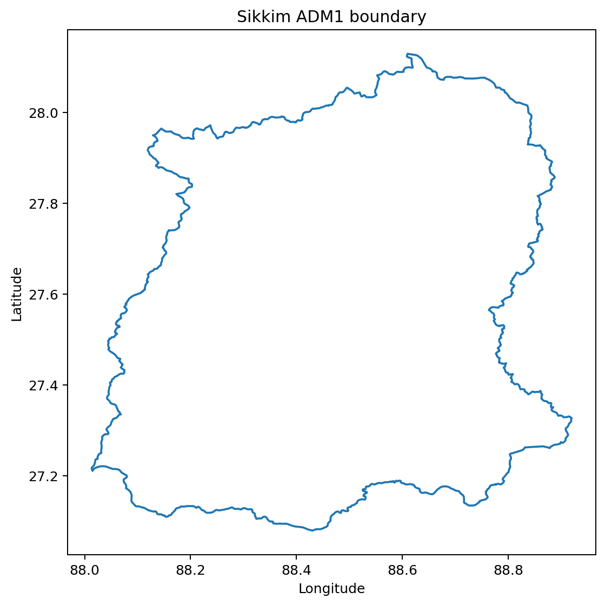

# AI-Based Landslide Risk Assessment and Early Warning System

MVP for Sikkim, India. The app separates static susceptibility from rainfall-triggered risk. It does not predict exact time or occurrence.

## Quick start
```powershell
py -3.11 -m venv .venv
.\.venv\Scripts\Activate.ps1
pip install -r requirements.txt
streamlit run app/streamlit_app.py
```

The dashboard starts in clearly labelled demonstration mode using deterministic synthetic feature points for UI smoke testing only. These are not historical records. Supply a real CSV/GeoJSON/Shapefile inventory with `latitude,longitude,label` and feature columns, then run `python -m src.models.train --inventory data/raw/landslides.geojson`.

No external datasets are bundled or claimed acquired. See `reports/dataset_documentation.md`. Add SRTM/WorldCover/SoilGrids/rainfall/OSM and the NRSC/Bhuvan inventory through the documented workflow.

This workspace had no configured Git remote. Add yours and push without force: `git remote add origin https://github.com/<user>/<repo>.git; git push -u origin main`.

## MVP architecture

`app/streamlit_app.py` provides Overview, Risk Map, Prediction, Rainfall Analysis, Terrain Analysis, Model Evaluation, and Dataset Explorer tabs. `src/data` handles boundary, inventory, and raster ingestion; `src/features` handles terrain derivatives; `src/models` trains serializable models; `src/risk` provides the transparent heuristic engine.

Run `streamlit run app/streamlit_app.py`. If real DEM, rainfall, or inventory files are missing, the dashboard remains usable in explicitly labelled demonstration mode. Demonstration model metrics are not scientific validation. A boundary visualization is available at `reports/figures/sikkim_boundary.png`.

The primary workflow is now on the landing page under **Landslide risk prediction**. Enter coordinates, terrain, and rainfall, then select **ANALYZE LANDSLIDE RISK**. The result separates demonstration susceptibility from the heuristic rainfall-triggered score and explains the contributing factors.

## Problem and objectives

Sikkim has steep terrain and rainfall-triggered slope instability. This MVP provides two distinct outputs: a static susceptibility score based on environmental features, and a rainfall-adjusted heuristic risk category. It is designed for transparent demonstration and data replacement, not exact event or time prediction.

## Architecture

```text
Raw/manual datasets -> validation + CRS normalization -> feature extraction
       |                         |                         |
       +--> boundary/inventory   +--> terrain rasters      +--> rainfall accumulations
                                                               |
                                      susceptibility models <-+
                                               |
                         susceptibility + recent rainfall -> heuristic risk
                                               |
                                      Streamlit / Folium / Plotly UI
```

## Technologies

Python 3.11+, Pandas, NumPy, scikit-learn, XGBoost, GeoPandas, Rasterio, Shapely, PyProj, Folium, Streamlit, Streamlit-Folium, Plotly, Matplotlib, SHAP, and Joblib. XGBoost/SHAP are optional at runtime for graceful operation when their platform wheels are unavailable.

## Data sources and methodology

The validated boundary is from geoBoundaries. Intended replaceable sources are NRSC/ISRO Landslide Atlas or Bhuvan, NASA SRTM/Earthdata, NASA GPM IMERG, ESA WorldCover, ISRIC SoilGrids, and OpenStreetMap. See `reports/dataset_documentation.md` for status, licensing, resolution, and limitations.

Terrain derivatives are calculated in projected metres. Models use imputation, scaling where appropriate, class balancing, and spatial group validation when coordinates are available. The rainfall engine uses configurable thresholds and reports a heuristic score, never a calibrated probability.

## Reproducible demonstration

The demo requires no large external datasets:

```powershell
python -m venv .venv
.\.venv\Scripts\Activate.ps1
pip install -r requirements.txt
python -m pytest -q
python -m src.models.train
streamlit run app/streamlit_app.py
```

Click **Run demonstration training** in the Model Evaluation tab. All synthetic points and metrics are explicitly labelled demonstration-only. Real inventory data must be supplied before reporting scientific performance.

## Visual documentation

Validated Sikkim boundary:



## Results and limitations

The dashboard, risk engine, boundary workflow, inventory adapters, raster utilities, and demonstration training pipeline are functional. The repository does not claim a real historical inventory, rainfall series, or processed DEM unless the corresponding files are actually imported and validated. Automatic SRTM download may require a stable connection; manual GeoTIFF import is supported by the raster validation utilities.
